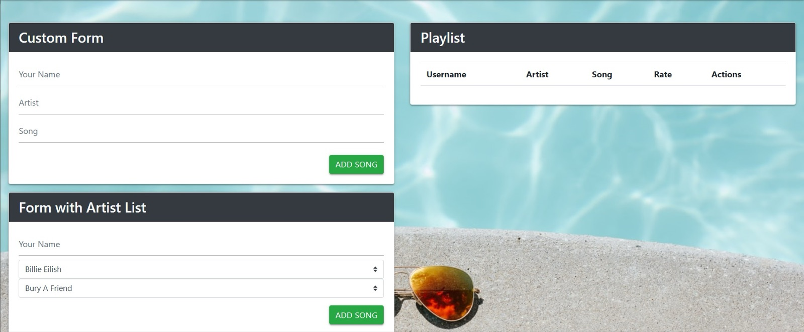

<div align="center">

# 🎵 miladmo68.github.io

My GitHub Pages user site. It currently hosts the Milad Playlist app.

<a href="https://github.com/miladmo68/miladmo68.github.io"></a>
<a href="https://miladweb.com"></a>

</div>

<p align="center">
  
</p>

## ✨ Features

- Playlist form and table
- HTML, CSS and JavaScript

## 🛠️ Tech Stack

   

> [!NOTE]
> There is no hosted demo for this project. Run it locally with the steps below.

## 🚀 Getting Started

**Run locally**

```bash
git clone https://github.com/miladmo68/miladmo68.github.io.git
cd miladmo68.github.io
# open index.html in your browser, or serve the folder:
npx serve .
```

## 📁 Project Structure

```
miladmo68.github.io/
├── css/
├── images/
├── app.js
└── index.html
```

## 👤 Author

**Milad Mohammadi** — Frontend-Focused Full-Stack Developer, Toronto 🇨🇦

[](https://miladweb.com)
[](https://www.linkedin.com/in/miladmo68/)
[](https://github.com/miladmo68)

<p align="center"><sub>If you like this project, consider giving it a ⭐</sub></p>
